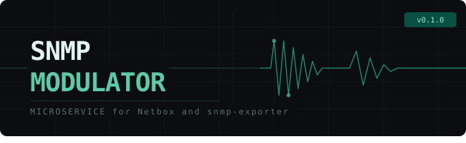
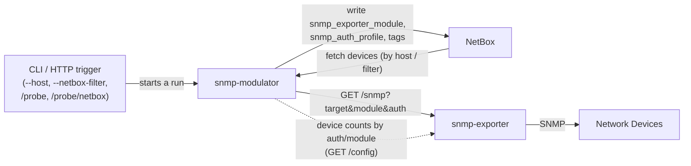

# SNMP MODULATOR

[](https://github.com/zebbra/snmp-modulator/actions/workflows/ci.yml)
[](https://quay.io/repository/zebbra/snmp-modulator)

<p align="center">
  
</p>

Probes NetBox devices against [snmp-exporter](https://github.com/prometheus/snmp_exporter) modules
and writes back the `snmp_exporter_module` custom field with only the modules that return useful data.
Optionally discovers and validates SNMP auth profiles.

---

## Architecture



Two ways to run it: the **server** (`server.py`) runs probes on demand when `/probe` or `/probe/netbox` is called, exposing Prometheus metrics continuously; the **CLI** (`cli.py`) does a single one-shot run and exits. Both share the same `Modulator`/`MappingEngine` core in `modulator.py`.

---

## How it works

1. Fetch devices from NetBox (by host or filter)
2. Evaluate which modules to `add` (unconditional), `try` (probe), or `block` (veto) — from `mapping.yaml`
3. Probe each `try` module: `GET /snmp?target=<ip>&module=<module>&auth=<profile>`
4. Keep modules that return at least one non-housekeeping metric (`up=1` alone doesn't count)
5. Write the final module list back to `snmp_exporter_module` in NetBox

Auth discovery (optional): before module probing, validate or discover the SNMP auth profile by
probing a canary module and checking `up=1`. Written back to `snmp_auth_profile` if changed.

---

## NetBox custom fields

| Field | Type | Required | Direction |
|---|---|---|---|
| `snmp_exporter_module` | multi-select (choice set) | yes | read + **write** — final module list |
| `snmp_auth_profile` | text | yes | read + **write** (when auth probing resolves a different profile) |
| `snmp_polling_interval` | selection | no | read + **write** — Prometheus scrape interval; choice set provides the step ladder |
| `snmp_polling_timeout` | selection | no | read + **write** — Prometheus scrape timeout; choice set provides the step ladder |
| `snmp_exporter_module_fast` | multi-select (choice set) | no | read + **write** — fast-profile module list (e.g. `if_traffic`); see [Fast polling profile](#fast-polling-profile) |
| `snmp_polling_interval_fast` | selection | no | read + **write** — fast-profile scrape interval |
| `snmp_polling_timeout_fast` | selection | no | read + **write** — fast-profile scrape timeout |
| `snmp_modulator_last_updated` | date | no | **write** — set to today whenever a device is actually changed; untouched on no-op runs |

The two mandatory fields must exist on all devices the modulator processes. Field names are configurable in `mapping.yaml` (`modules.field`, `auth.field`) and can be overridden per-run via CLI.

Optional fields are only written when enabled in `mapping.yaml`:
- `snmp_polling_*` — only when `modules.interval_field` / `modules.timeout_field` are set; omit both to measure and log durations without writing
- `snmp_exporter_module_fast` / `snmp_polling_*_fast` — only when `modules.fast.field` is set; see [Fast polling profile](#fast-polling-profile)
- `snmp_modulator_last_updated` (or whatever `touch_field` names) — set/omit `touch_field` to enable/disable; must exist as a NetBox custom field on `dcim.device` before enabling

---

## mapping.yaml

All probe behaviour is controlled by `mapping.yaml`.

### Global Settings

```yaml
touch_field: snmp_modulator_last_updated  # date field set on any real change; omit/empty to disable
pin_tag: pin-snmp   # device tagged with this NetBox tag slug is skipped entirely on batch runs; omit/empty to disable

modules:
  field:  snmp_exporter_module  # NetBox multi-select custom field
  policy: drop                  # use | try | drop

  # Optional fast polling profile — see "Fast polling profile" below.
  fast:
    field:            snmp_exporter_module_fast
    interval_field:   snmp_polling_interval_fast
    timeout_field:    snmp_polling_timeout_fast
    default_interval: 1m
    default_timeout:  20s

auth:
  field:        snmp_auth_profile        # NetBox text custom field
  policy:       use                      # use | try | drop
  probe_module: system                   # canary module for auth probing; override per-rule
```

`modules.policy` — how to treat modules already in the field at run start:

| Value | Meaning |
|---|---|
| `use` | Keep existing modules unconditionally (non-destructive / append mode) |
| `try` | Re-probe existing modules; keep if still useful |
| `drop` | Ignore existing modules (default) |

`auth.policy` — how to handle the SNMP auth profile:

| Value | Meaning |
|---|---|
| `use` | Trust NetBox value as-is; no probing. May be overridden per-rule with `auth.try`. |
| `try` | Probe rule candidates in declared order; NetBox value appended as last-resort fallback |
| `drop` | Ignore NetBox value; discover working profile from rule candidates only |

Rule-level `auth.try` is always probed in the order written — the rule author's preference (e.g. v3 before v2) is honored. With global `policy=try`, the device's current NetBox profile is appended to the end of the candidate list as a final fallback (deduped if already present).

### Pinning a device

`pin_tag` names a NetBox tag slug (e.g. `pin-snmp`) that means "a human has set
this device's auth/modules/polling deliberately — don't overwrite it." A
tagged device is skipped entirely (auth, modules, polling all left exactly as
they are) — but **only on batch runs**: `/probe/netbox`, `cli.py
--netbox-filter`, or anything scheduled. An *explicit* single-host request
(`/probe?host=X`, `cli.py --host`) always processes the device regardless of
the tag — naming a specific host is itself a deliberate decision to change it,
so the pin doesn't apply there. This can't be expressed as a normal mapping.yaml
rule (rules only ever see device attributes, never *how* the run was
triggered) — it's controlled by the `Modulator(honor_pins=...)` constructor
argument, which server.py/cli.py set based on the request type.

A pinned device is reported as `skipped: "pinned"` (not `error`) on its
`ModulationResult`, and as `result="pinned"` on `modulator_devices_processed_total`
— it's a deliberate no-op, not a failure.

### Liveness gate

`MODULATOR_LIVENESS_URL` (env var, not mapping.yaml — see [Environment
variables](#environment-variables)) enables a pre-probe check against a
Prometheus-compatible API: before a batch run probes a device, ask whether
it's actually up, and skip the SNMP round-trip entirely if not. SNMP itself
isn't a reliable down-signal — wrong creds or a wrong module looks identical
to actually-down — but a dedicated ICMP/ping check is. Same batch-only,
fail-open reasoning as `pin_tag` (and the same `honor_pins` flag gates both):
an explicit single-host request always probes regardless, and a device
missing from the query results (never monitored, or the query itself failed)
is processed normally rather than skipped — only an explicit "down" verdict
skips it. Reported as `skipped: "offline"`, and `modulator_liveness_query_up`
tracks whether the last query itself succeeded.

### defaults

Applied to every device before rules are evaluated:

```yaml
defaults:
  modules:
    add:   []
    try:   [system, if_full]   # probed — only written if they return useful data
    block: []
  auth:
    try: []    # fallback auth candidates when global auth.policy: try/drop and no rule matches
```

### Per-rule operations

Each rule has `modules` and `auth`, mirroring the top-level structure:

```yaml
- name: "Example rule"
  match:
    device_type.manufacturer.slug: "cisco"
    role.slug: "switch"
  modules:
    add:
      - if_full          # always in final set, no probe
    try:
      - cisco_generic    # probe — include only if useful data returned
      - _ALL             # expand to every module known to snmp-exporter (/config)
    block:
      - if_mib           # veto — wins over add/try from any rule
      - _ALL             # nuclear veto — final list is empty regardless of other rules
    interval: 15m        # floor — recommended normal interval never goes below this
    timeout:  5m
    fast:                # opt-in fast profile — see "Fast polling profile" below
      try:
        - if_traffic
      interval: 1m
      timeout:  20s
  auth:
    try:                 # probe in order; first returning up=1 wins
      - SNMPV3_Foo       # try v3 first, works well when you are in a rolling v2-> v3 migration 
      - SNMPV2_legacy    # fallback to snmpv2 if v3 doesn't answer
      - _ALL             # expand to every auth profile known to snmp-exporter (/config)
    probe_module: if_mib # canary module override for this rule's auth probing
```

Any NetBox field reachable by dot-notation is a valid `match` key:
`role.slug`, `device_type.manufacturer.slug`, `device_type.model`, `platform.slug`,
`site.slug`, `status.value`, `custom_fields.<name>`, `name`, `tags`, etc.

List fields (`tags`) match if **any** element matches. Tags are matched by slug.

Absent match keys are wildcards. All patterns are `re.fullmatch` (case-insensitive).


<details>
<summary><strong>Full mapping.yaml example</strong></summary>

```yaml
modules:
  field:            snmp_exporter_module
  policy:           drop
  interval_field:   snmp_polling_interval
  timeout_field:    snmp_polling_timeout
  default_interval: 3m
  default_timeout:  2m

auth:
  field:        snmp_auth_profile
  policy:       use
  probe_module: system

defaults:
  modules:
    add:   []
    try:   [system, if_full]
    block: []
  auth:
    try:
      - _ALL

rules:

  # ── Cisco new-access (C9200/C9300) ──────────────────────────────
  - name: "Cisco new-access (C9200/C9300)"
    match:
      device_type.manufacturer.slug: "cisco"
      device_type.slug: "C9[23]0[05].*"
    modules:
      add:
        - if_full
      block:
        - if_full_legacy
        - if_error
        - if_status
      try:
        - cisco_generic
        - cisco_sensor
        - cisco_envmon
        - cisco_process
        - cisco_stackwise
        - cisco_rf

  # ── Cisco NX-OS ─────────────────────────────────────────────────
  - name: "Cisco NX-OS"
    match:
      device_type.manufacturer.slug: "cisco"
      custom_fields.os_name: ".*NX-OS.*"
    modules:
      add:
        - if_full
      block:
        - if_mib
        - cisco_envmon
        - cisco_stackwise
      try:
        - cisco_generic
        - cisco_sensor
        - cisco_process

  # ── Fortinet FortiGate (default) ────────────────────────────────
  - name: "Fortinet FortiGate"
    match:
      device_type.manufacturer.slug: "fortinet"
    auth:
      use: SNMPV3_FORTINET
    modules:
      try:
        - fortinet_fortigate

  # ── Fortinet FortiManager ────────────────────────────────────────
  - name: "Fortinet FortiManager"
    match:
      device_type.manufacturer.slug: "fortinet"
      custom_fields.snmp_auth_profile: ".*FortiManager.*"
    auth:
      use: SNMPV3_FORTINET
    modules:
      block:
        - fortinet_fortigate
      try:
        - fortinet_fortimanager

  # ── LWAPP APs — no SNMP ─────────────────────────────────────────
  - name: "Cisco LWAPP APs"
    match:
      role.slug: "lwapp-ap"
    auth:
      use: ~
    modules:
      block:
        - _ALL

  # ── Vendor-scoped auth discovery ────────────────────────────────
  # Auth is first-match — more specific rules above may have already won.
  # If no vendor rule matches, auth falls through to defaults.auth.try.
  - name: "Cisco — auth discovery"
    match:
      device_type.manufacturer.slug: "cisco"
      custom_fields.snmp_auth_profile: ""
    auth:
      try:
        - SNMPV3_L3
        - SNMPV3_L2

  - name: "Fortinet — auth discovery"
    match:
      device_type.manufacturer.slug: "fortinet"
      custom_fields.snmp_auth_profile: ""
    auth:
      try:
        - SNMPV3_FORTINET

  # ── Last-resort tag-driven discovery ────────────────────────────
  # Tag a device "discover" to run a full blind discovery:
  #   - auth.try: _ALL overrides global auth_policy=use — tries every known profile
  #   - modules: tries every module known to snmp-exporter
  # On success: removes the discover tag.
  # On failure: adds fix-snmp tag for manual follow-up.
  - name: "Last-resort discovery (tag-driven)"
    match:
      tags: "discover"
    auth:
      try:
        - _ALL
    modules:
      try:
        - _ALL
    on_success:
      remove_tag:
        - discover
        - fix-snmp
      notify: http://nexttool/done
    on_fail:
      add_tag: [fix-snmp]
```

</details>


### Handlers

Each rule can define `on_success` and `on_fail` blocks that run after the probe completes.
Handlers from all matching rules are accumulated.

| Key | Meaning |
|---|---|
| `add_tag: [slug, ...]` | Add NetBox tag(s) to the device |
| `remove_tag: [slug, ...]` | Remove NetBox tag(s) from the device |
| `notify: <url>` | HTTP GET to URL (fire-and-forget) |

Tag changes are batched with the module write when modules changed — one API call.
`on_success` fires when the final module set is non-empty and no probe errors occurred.
`on_fail` fires when: any module probe returned an error, the final module set is empty (nothing useful found), or the device was skipped due to auth failure.

```yaml
- name: "Discover SNMP"
  match:
    tags: "discover"
  modules:
    try:
      - _ALL
  on_success:
    remove_tag: [discover]
    notify: http://nexttool/done
  on_fail:
    add_tag: [fix-snmp]
```

### Resolution order

**Auth** (first-match — stops at first matching rule with an `auth:` section):
1. Walk rules in order; for the first matching rule with an `auth:` section:
   - `auth.use` → use that profile directly, no probe (global policy irrelevant)
   - `auth.use: ~` → clear the field, no probe (global policy irrelevant)
   - `auth.try` → build candidate list — fires regardless of global `auth.policy`:
     - `auth.policy: try` → prepend current NetBox value to candidates
     - `_ALL` → expand to every profile from snmp-exporter `/config`
     - probe each in order; first returning `up=1` wins
2. No matching rule → apply global `auth.policy` as fallback:
   - `use` → trust NetBox value as-is, no probing, done. **Empty auth → device skipped (no point probing)**
   - `try` → prepend NetBox value to `defaults.auth.try` candidates, then probe
   - `drop` → use `defaults.auth.try` candidates only, then probe
3. No candidate succeeds → **device skipped entirely, no module probing**
4. Resolved profile differs from NetBox value → write back (respects `dry_run`)

> **Auth is first-match; modules are accumulative.** A device can match many rules — all
> contribute to the module test set (duplicates deduplicated automatically), but only the first
> matching rule with an `auth:` section is used for auth. To write a fallback auth-discovery rule
> that only fires for devices with no profile yet, add `custom_fields.snmp_auth_profile: ""`
> to its `match:` block. If the modules it introduces are already covered by earlier rules,
> the guard is optional — the duplicate probes are simply deduplicated.

**Modules** (accumulative — all matching rules contribute):
1. Seed from `defaults.modules` (`add`, `try`, `block`)
2. Walk all rules; each matching rule accumulates into `add`, `try`, `block`
   - `_ALL` in `block` → return empty immediately, skip remaining steps
   - `_ALL` in `try` → expand to every module from snmp-exporter `/config`
3. `block` veto: remove from `add` and `try`
4. Drop any module name not known to snmp-exporter (per `/config`) from both `add`
   and `try` — a typo'd or stale module name in mapping.yaml would otherwise waste
   a doomed probe, or get written to NetBox for a module that can never be
   scraped. Logged as a warning. Skipped entirely (nothing dropped) if
   snmp-exporter's `/config` failed to load — better to attempt everything than
   have a transient fetch failure silently wipe every module.
5. Probe each `try` module; keep those returning useful data
6. Final: `sorted(add ∪ useful_try)`

---

## Environment variables

| Variable | Default | Description |
|---|---|---|
| `NETBOX_URL` | required | NetBox base URL |
| `NETBOX_TOKEN` | required | NetBox API token |
| `NETBOX_TLS_VERIFY` | `true` | Verify NetBox TLS certificate |
| `SNMP_EXPORTER_URL` | required | snmp-exporter base URL |
| `SNMP_EXPORTER_TLS_VERIFY` | `true` | Verify snmp-exporter TLS certificate |
| `SNMP_EXPORTER_TIMEOUT` | `30` | Per-probe timeout in seconds |
| `MAPPING_FILE` | `mapping.yaml` | Path to mapping config |
| `MODULATOR_DRY_RUN` | `false` | Log changes without writing to NetBox |
| `MODULATOR_DRY_RUN_CACHE_TTL` | `300` | Seconds a dry-run `/probe` result is remembered for; a plain (non-dry-run) `/probe` call for the *same* host within this window commits it for real without re-probing. `0` disables the cache |
| `MODULATOR_EDIT_RESULT_TTL` | `86400` | Seconds a finished `/modules/add\|remove\|replace` job stays available via `GET /modules/result?job=<id>` |
| `MODULATOR_PROBE_RESULT_TTL` | `300` | Seconds a finished probe result stays available via `GET /probe/result?host=X` before that endpoint 404s and a new probe must be submitted |
| `MODULATOR_AUTH_TOKEN` | unset | Bearer token for `/probe` endpoints (disabled if unset) |
| `MODULATOR_PORT` | `8080` | Server listen port |
| `MODULATOR_WORKERS` | `4` | uvicorn worker count |
| `MODULATOR_MAX_CONCURRENT_RUNS` | `1` | Max simultaneous probe jobs (per worker) |
| `MODULATOR_DEVICE_PARALLELISM` | `1` | Devices probed concurrently within a single run (1 = sequential). SNMP probing is I/O-bound, so 10–20 is usually a safe sweet spot |
| `MODULATOR_NETBOX_REFRESH_INTERVAL` | `3600` | Seconds between NetBox device-count gauge refreshes (set `0` to disable) |
| `PROMETHEUS_MULTIPROC_DIR` | auto | Multiprocess Prometheus metrics directory. Auto-set to `/tmp/modulator_metrics` when `MODULATOR_WORKERS>1`; set explicitly to override |
| `MODULATOR_METRICS_PATH` | `/metrics` | Prometheus metrics endpoint path |
| `MODULATOR_LIVENESS_URL` | unset | Prometheus-compatible API (e.g. VictoriaMetrics vmselect) to query for device liveness before a batch run probes it. Unset disables the feature entirely |
| `MODULATOR_LIVENESS_QUERY` | `probe_success{job="network-netbox-ping"}` | Instant PromQL query; each series maps to a device via `MODULATOR_LIVENESS_LABEL` |
| `MODULATOR_LIVENESS_LABEL` | `instance` | Which series label holds the matching key |
| `MODULATOR_LIVENESS_KEY` | `name` | Which device attribute that key is — `name` or `ip` (`device.primary_ip`) |
| `MODULATOR_LIVENESS_TIMEOUT` | `15` | Liveness query HTTP timeout, seconds |
| `MODULATOR_LIVENESS_TLS_VERIFY` | `true` | Verify TLS on the liveness query endpoint |

`modules.policy`, `auth.policy`, and field names are configured in `mapping.yaml`.
They can be overridden per-run with CLI arguments but not via environment variables.

---

## CLI reference

```
python cli.py [OPTIONS]

Options:
  --host TEXT               Device IP or hostname (mutually exclusive with --netbox-filter)
  --netbox-filter TEXT      URL-encoded NetBox filter, e.g. "role=switch&site=dc1"
  --mapping TEXT            Path to mapping.yaml  [default: mapping.yaml]
  --module-policy [use|try|drop]  Override mapping.yaml modules.policy
  --auth-policy [use|try|drop]  Override mapping.yaml auth_policy
  --module-field TEXT       Override mapping.yaml netbox_fields.module_field
  --auth-field TEXT         Override mapping.yaml netbox_fields.auth_field
  --dry-run                 Log changes without writing to NetBox
  --device-parallelism INT  Devices probed concurrently within one run (default 1)
  --debug                   Enable debug logging
```

---

## Server endpoints

| Endpoint | Description |
|---|---|
| `GET/POST /probe?host=<ip\|name>` | Probe a single device |
| `GET /probe/result?host=<ip\|name>` | Poll a queued probe's progress or finished result |
| `GET/POST /probe/netbox?<filter>` | Probe devices matching any NetBox filter |
| `GET/POST /modules/add?module=<m>&<filter>` | Add module(s) — no probing, see [Bulk module edits](#bulk-module-edits) |
| `GET/POST /modules/remove?module=<m>[&<filter>]` | Remove module(s) — no probing |
| `GET/POST /modules/replace?old=<m>&new=<m>[&<filter>]` | Replace module(s) — no probing |
| `GET /modules/result?job=<id>` | Poll a `/modules/*` job |
| `GET /health` | Liveness check |
| `GET /metrics` | Prometheus metrics |
| `GET /docs` | Swagger UI |

NetBox filter params are passed directly to `dcim.devices.filter()`:

```
/probe/netbox?role=switch&site=dc1
/probe/netbox?manufacturer=cisco&last_updated__lt=2025-10-01
/probe/netbox?tag=discover
```

### Polling instead of `wait=true`

Module probing on a single device is always serial — never parallel, that risks
overloading fragile devices — so a device with several slow modules can take
well past a typical HTTP/proxy timeout if you hold `/probe?wait=true` open for
the whole thing. `GET /probe/result?host=<same host>` avoids that: submit with
the default fire-and-forget mode (`POST /probe?host=X`, returns 202 instantly),
then poll `/probe/result?host=X` every second or two instead of blocking one
request:

```
GET /probe/result?host=10.0.0.5
  -> 202 {"status": "running", "host": ..., "result": {"test_results": [...], ...}}
  -> 200 {"status": "done",    "host": ..., "dry_run": ..., "result": {...full ModulationResult}}
  -> 404 no probe found for this host — submit one first, or it expired (MODULATOR_PROBE_RESULT_TTL)
```

`result` has the **same shape** in both states — while running, only
`test_results` (modules probed so far, each tagged `profile: "normal"|"fast"`)
is populated; everything else is null/empty until `status` flips to `"done"`.
Keyed by `host`, same as `/probe` — no job id to track, just re-GET the same
URL. `MODULATOR_PROBE_RESULT_TTL` (default 300s) controls how long a finished
result stays available to poll for.

### Bulk module edits

For a fast fleet-wide rollout (e.g. a new module that should go out *now*,
without re-probing thousands of devices), `/modules/add`, `/modules/remove`
and `/modules/replace` edit the module field directly in NetBox — no SNMP
probing, no `mapping.yaml` rules. One NetBox bulk PATCH per 100 devices, so
10k devices take a minute or two instead of hours.

```
POST /modules/add?module=if_updown_state&cf_snmp_exporter_module=if_full
POST /modules/remove?module=cisco-generic
POST /modules/replace?old=if_status,if_error,if_traffic&new=if_full
POST /modules/add?module=if_updown_state&cf_snmp_exporter_module=if_full&cf_snmp_exporter_module__n=if_updown_state&site=dc1
```

- `module`, `old`, `new` take comma-separated or repeated values; `profile=fast`
  targets the fast-profile field (`modules.fast.field`) instead of the normal one.
- Every other query parameter is a NetBox filter, exactly as for `/probe/netbox`.
  `/modules/add` requires one; `/modules/remove` and `/modules/replace` always
  narrow the query to devices carrying one of the removed modules
  (`cf_<field>=<module>`), so a filter there is optional.
- `replace` only adds `new` on a device that actually had one of `old` — a
  broad filter never hands `new` to a device that didn't have the old modules.
- A module to add that already sits in the *other* profile's field is left
  where it is (reported as `in_other_profile`).
- Modules to add are validated against the NetBox choice set and snmp-exporter
  before anything is queued (400 on a typo).
- Pinned devices are skipped. `touch_field` is **not** set — it means "last
  probed", and this isn't a probe. Changes carry the changelog message
  `SNMPModulator module edit: +if_updown_state -…`. `MODULATOR_DRY_RUN` is honored.

Always async — returns 202 with a `job` id; poll `GET /modules/result?job=<id>`
(202 while running, 200 once `done`/`failed`). The result has per-device
counts and lists only the devices that changed, were skipped or errored.
Job state lives in files under `PROMETHEUS_MULTIPROC_DIR`, so polling works
across uvicorn workers.

**Not sticky:** the next probe run with `modules.policy: drop` recomputes the
field from `mapping.yaml` and drops modules no rule produces. Add a matching
rule, or the edit is undone device by device as they're re-probed.

---

## Prometheus metrics

```
modulator_devices_processed_total{result="success|error|unreachable"}
modulator_module_tests_total{module="<name>", result="useful|empty|error"}
modulator_module_test_duration_seconds{module="<name>"}
modulator_netbox_updates_total{action="changed|unchanged"}
modulator_module_changes_total{module="<name>", action="added|removed"}
modulator_auth_probe_results_total{result="resolved|failed|skipped"}
modulator_probe_duration_seconds
modulator_probe_running
modulator_probe_queued
modulator_probe_queue_depth
modulator_liveness_query_up
modulator_netbox_devices_by_auth{profile="<name>"}
modulator_netbox_devices_by_module{module="<name>"}
modulator_netbox_devices_refresh_duration_seconds
```

`modulator_netbox_devices_by_auth` and `modulator_netbox_devices_by_module` are seeded from snmp-exporter `/config`, so every known profile/module appears — including with value `0` when no device uses it. That makes "find unused" a one-liner: `modulator_netbox_devices_by_auth == 0`. Refresh cadence is controlled by `MODULATOR_NETBOX_REFRESH_INTERVAL` (one cheap pagination-count query per known value, no full device fetch).

`modulator_probe_running` is jobs actively executing (semaphore slot held, bounded by `MODULATOR_MAX_CONCURRENT_RUNS`); `modulator_probe_queued` is every accepted-but-unfinished job (running + waiting); `modulator_probe_queue_depth` is waiting-for-a-slot only. So `queued - running == queue_depth` always holds, but `queue_depth` is there directly so you don't need the subtraction for an alert rule.

---

## Polling interval/timeout calculation

After module probing, the modulator calculates recommended polling timers based on measured scrape
durations. Measurement and logging always happen; write-back only occurs when
`modules.interval_field` / `modules.timeout_field` are set in `mapping.yaml`.

```
total    = sum of scrape_duration_seconds for all modules in the final set
timeout  = round_up(total × 1.5)  → next step in the timeout choice set
interval = round_up(timeout × 2)  → next step in the interval choice set
```

The step ladders are read from the NetBox selection custom fields (`snmp_polling_interval` / `snmp_polling_timeout`) at startup — the choice set on each field is the source of truth, so ops can adjust the allowed steps without redeploying. If either choice set is missing or unfetchable, polling calculation is **disabled** (logged at startup, no recommendation, no write-back); module probing continues normally.

Only modules that made it into the final set contribute to `total` — probed modules that returned
no useful data are excluded. Unconditional (`add`) modules are also excluded since they are not probed.

The field is written whenever the calculated value **differs** from the current NetBox
value — in either direction. The floor (global default, or a rule's `interval`/`timeout`
override — see below) is the only lower bound; a device's *current* NetBox value is not.
That's deliberate: if one unlucky slow probe pushes a device's interval up to `1h`, the
next normal-speed probe recovers it back down to its real floor instead of leaving it
stuck at `1h` forever just because `1h` happens to be higher than the floor. If the field
is empty, the defaults from `mapping.yaml` are used as the baseline:

```yaml
modules:
  default_interval: 3m
  default_timeout:  2m
```

Valid field values: `30s`, `1m`, `90s`, `2m`, `3m`, `4m`, `5m`, `10m`, `15m`.

### Reading the result

`polling_interval`/`polling_timeout` on a `/probe` result (and on `ModulationResult`)
are `null` unless this run actually wrote a new value — that's "what changed," not
"what's in effect." For "what's in effect regardless of whether anything changed,"
use `resolved_interval`/`resolved_timeout` (and their `_fast` counterparts) instead —
always populated whenever the relevant choice set is configured and fetchable, so a
`dry_run=true` preview of an already-correctly-configured device still reports real
numbers instead of nulls. Which modules ended up on the fast profile is in
`final_modules_fast`, alongside the normal list in `final_modules`.

### Rule-level interval/timeout floors

`modules.interval` / `modules.timeout` on a rule raise the floor the calculated
recommendation is held to, on top of `default_interval`/`default_timeout`. When
multiple matching rules set a floor, the highest wins. The floor applies to the
*recommendation itself*, not to "whatever's currently in NetBox" — so a rule can
force a slow/rarely-changing device to a longer interval even if it happens to
answer probes quickly (e.g. a remote site over a WAN link where fast polling
isn't worth the cost regardless of measured latency), while still letting the
value come back down to that floor later if something earlier had pushed it
higher:

```yaml
rules:
  - name: "Remote site (slow WAN link)"
    match:
      site.slug: "remote-.*"
    modules:
      interval: 15m
      timeout:  5m
```

### Fast polling profile

Some modules need tighter polling than the rest of a device's module list — e.g.
`if_traffic` for bandwidth graphs, while everything else is fine on a relaxed cadence.
The fast profile is a second, independent module/interval/timeout field set, opt-in
per rule via `modules.fast.{add,try,block}`:

```yaml
modules:
  fast:
    field:            snmp_exporter_module_fast
    interval_field:   snmp_polling_interval_fast
    timeout_field:    snmp_polling_timeout_fast
    default_interval: 1m
    default_timeout:  20s

rules:
  - name: "Remote site (slow WAN link)"
    match:
      site.slug: "remote-.*"
    modules:
      interval: 15m       # normal-profile floor
      timeout:  5m
      fast:
        try:
          - if_traffic
        interval: 1m      # fast-profile floor
        timeout:  20s
```

Notes:
- Omit `modules.fast` entirely at the top level to disable the feature outright — no fast field is ever read or written, regardless of what any rule declares.
- `add`/`try`/`block` inside `modules.fast` work exactly like the normal profile (unconditional / probe-tested / veto), including `_ALL`. There's no `defaults.modules.fast` — fast polling is opt-in per rule only.
- A module resolved into the fast profile is **removed from the normal one** — nothing is probed or polled twice under both profiles.
- `modules.fast.interval` / `modules.fast.timeout` are floors on the fast-profile recommendation, exactly like `modules.interval`/`modules.timeout` are for the normal one.
- `module_policy` (`use`/`try`/`drop`) applies identically to both profiles' existing module lists.

---

## Quick start

```bash
cp .env.example .env
# fill in NETBOX_URL, NETBOX_TOKEN, SNMP_EXPORTER_URL

# dry-run a single device
docker compose run --rm cli --host 10.0.0.1 --dry-run --debug

# dry-run all switches in a site
docker compose run --rm cli --netbox-filter "role=switch&site=dc1" --dry-run

# start the server
docker compose up modulator
```

---

